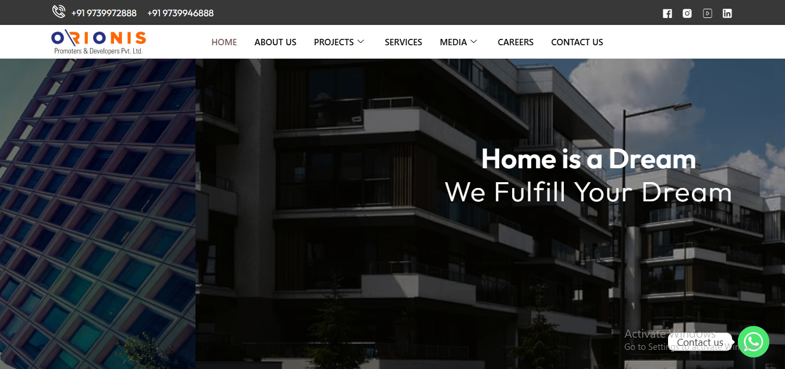
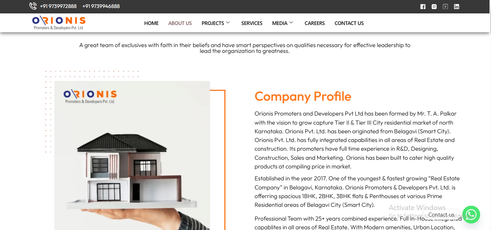
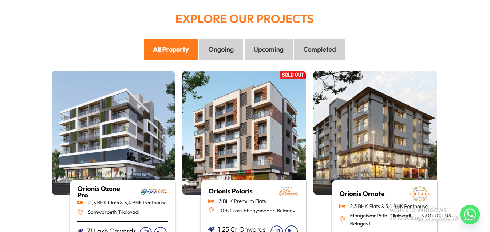
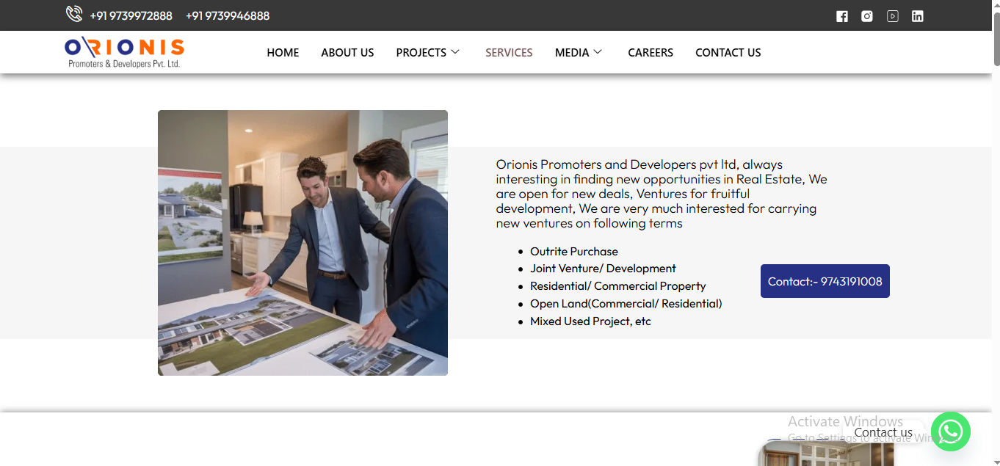

# Orionis

- **Live website:** [https://www.orionis.in/](https://www.orionis.in/)
- **Platform:** WordPress
- **Page builder:** Elementor
- **Local development environment:** XAMPP

## Project overview

Orionis is a professional real estate website developed for Orionis Promoters & Developers Pvt. Ltd., showcasing residential properties and real estate developments in Belagavi.

The website provides visitors with an overview of the company's residential projects, including apartments, flats and penthouses. It features dedicated property listings categorized into Ongoing, Upcoming and Completed projects, helping users explore available developments, property configurations, locations and starting prices.

## My contribution

Developed website pages using WordPress and Elementor.

Designed and structured website layouts to present real estate projects professionally.

Created and customized sections for the homepage, company profile and project information.

Organized property listings into Ongoing, Upcoming and Completed categories.

Integrated project information, property images and relevant content into website sections.

Customized page layouts, typography, colors and visual elements.

Worked on responsive layouts for desktop, tablet and mobile devices.

Configured website components and plugins to support the required functionality.

Worked on website content organization and overall user experience.

## Screenshots


```markdown




```

## Technologies

WordPress

Elementor

PHP

MySQL

HTML5

CSS3

JavaScript

XAMPP
