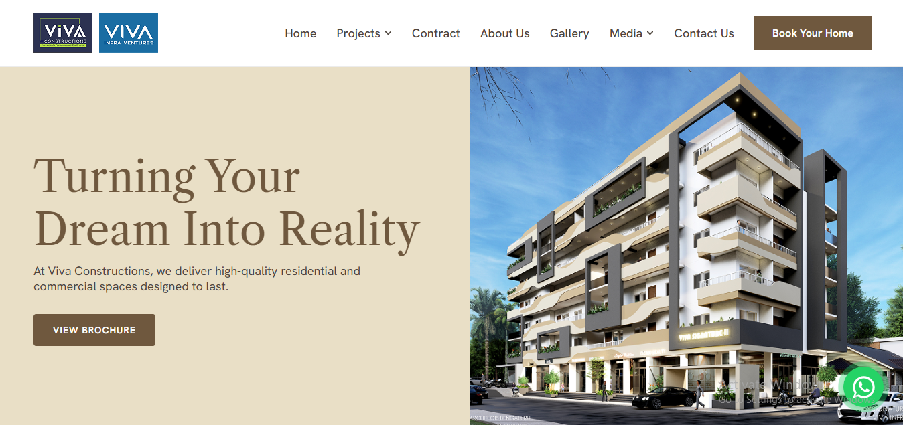
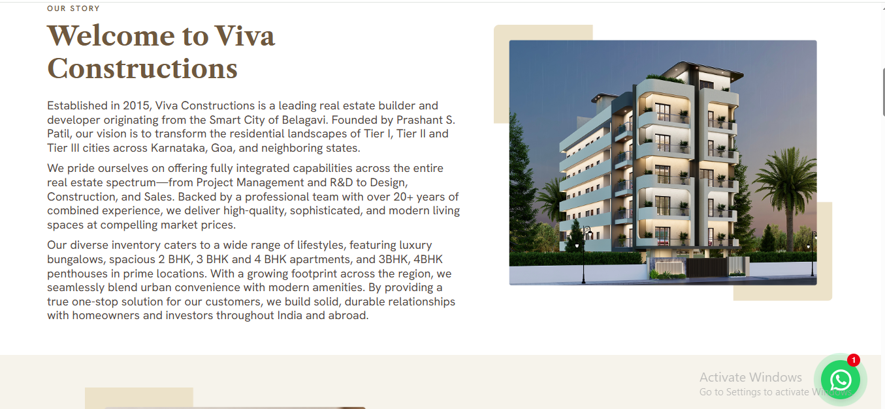
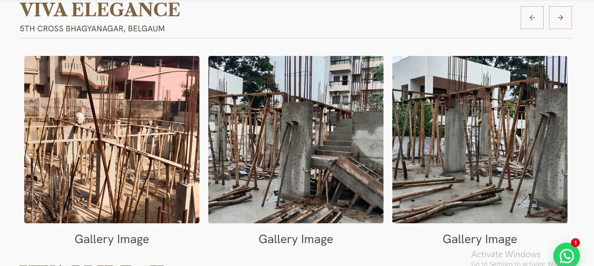

# Viva Constructions

- **Live website:** [https://www.vivaconstructions.in/](https://www.vivaconstructions.in/)
- **Platform:** WordPress
- **Page builder:** Elementor
- **Local development environment:** XAMPP

## Project overview

Viva Constructions is a real estate and residential development website designed to showcase the company's residential projects and provide potential customers with detailed property information.

The website presents multiple residential developments, including apartments and premium residential properties. It provides information about individual projects, property configurations, floor plans, project highlights and location details.

## My contribution

Developed website pages using WordPress and Elementor.

Designed and customized website layouts for a professional real estate presentation.

Created and structured residential project sections.

Organized multiple property listings and project information.

Integrated project images, property details and floor plan sections.

Customized homepage, company information and project detail layouts.

Designed enquiry and contact sections to help visitors connect with the company.

Customized typography, colors, spacing and website components.

Worked on responsive layouts for desktop, tablet and mobile devices.

Configured WordPress plugins and website components according to project requirements.

## Screenshots

Add screenshots captured from this project to the `screenshots/` folder, then embed them here:

```markdown




```

## Technologies

WordPress

Elementor

PHP

MySQL

HTML5

CSS3

JavaScript

XAMPP
