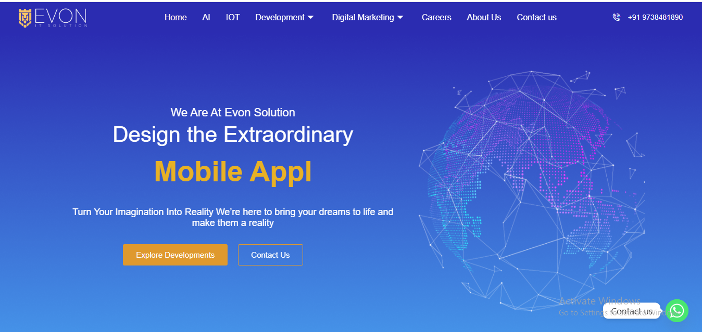
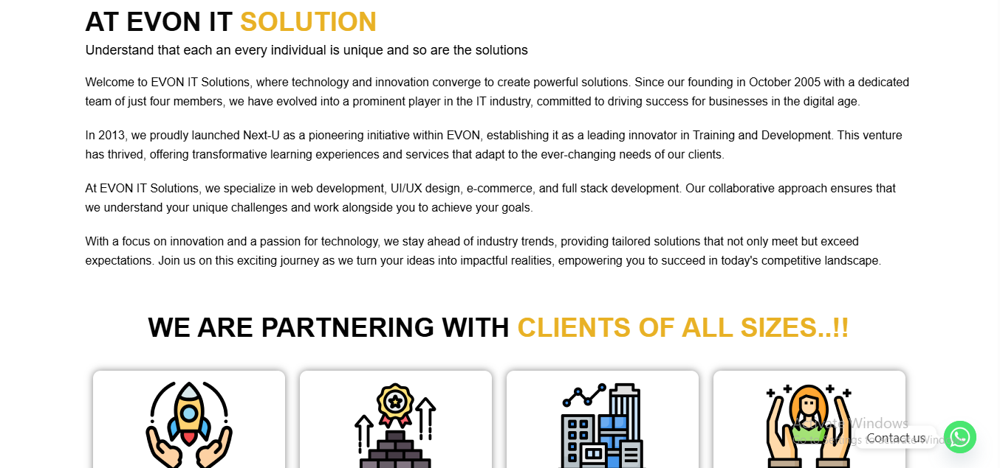

# Evon It Solution

- **Live website:** [https://www.evonitsolution.com/](https://www.evonitsolution.com/)
- **Platform:** WordPress
- **Page builder:** Elementor
- **Local development environment:** XAMPP

## Project overview

Evon IT Solution is a professional IT services and technology solutions website developed to showcase the company's digital services, software development capabilities, and technology training programs.

The website provides information about various services, including website development, UI/UX design, mobile application development, e-commerce solutions, ERP development, and digital marketing.

## My contribution

Developed and customized website pages using WordPress and Elementor.

Designed professional website layouts to represent the company's IT services and solutions.

Created and structured homepage sections, including company introduction and service highlights.

Developed and organized individual service sections for web development, UI/UX, mobile applications, e-commerce, and digital marketing.

Structured NEXT-U training and development sections to showcase courses and learning programs.

Integrated images, icons, content, and visual elements throughout the website.

Customized website layouts, typography, colors, spacing, and page components.

Worked on responsive website layouts for desktop, tablet, and mobile devices.

Configured WordPress plugins and website components according to project requirements.

Improved website content presentation, navigation, and overall user experience.

## Technologies

WordPress

Elementor

PHP

MySQL

HTML5

CSS3

JavaScript

XAMPP

## Screenshots

```markdown



```
