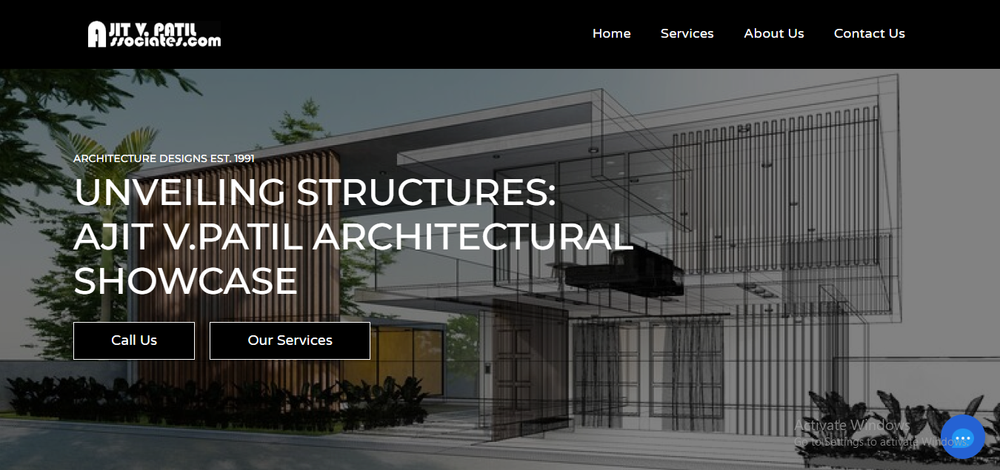
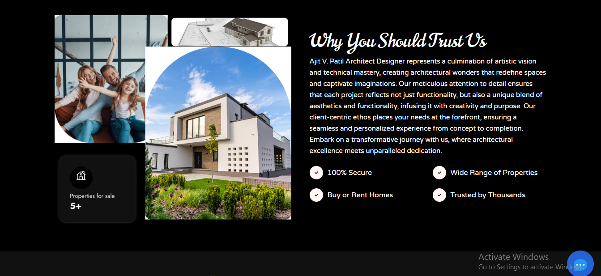
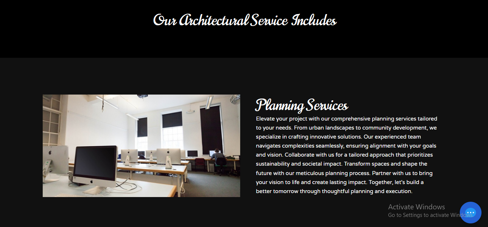
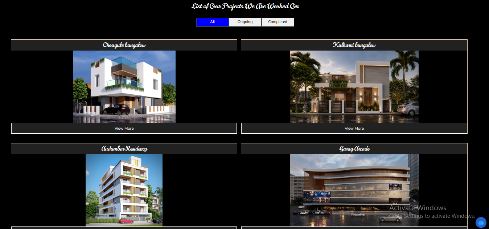

# Ajit V Patil Associates

- **Live website:** [https://ajitvpatilassociates.com/](https://ajitvpatilassociates.com/)
- **Platform:** WordPress
- **Page builder:** Elementor
- **Local development environment:** XAMPP

## Project overview

Ajit V Patil Associates is an architectural and real estate project showcase website developed to present the company's architectural work, residential developments, commercial projects and design portfolio.

The website provides visitors with information about ongoing and completed projects, including project details, locations, built-up areas, floor plans and 3D floor plans.

It also includes interactive project sections, map integration and enquiry forms that allow visitors to request project information and working drawings.

## My contribution

Developed and customized website pages using WordPress and Elementor.

Designed website layouts to showcase architectural projects and company information.

Created and organized residential and commercial project sections.

Structured project categories, including Ongoing and Completed projects.

Integrated project details such as builder information, location, project type and built-up area.

Customized project detail sections and property presentation layouts.

Worked on floor plan and 3D floor plan presentation sections.

Integrated map and project enquiry sections.

Customized website typography, colors, images and visual elements.

Worked on responsive layouts for desktop, tablet and mobile devices.

Configured WordPress components and plugins according to website requirements.

## Technologies

WordPress

Elementor

PHP

MySQL

HTML5

CSS3

JavaScript

XAMPP

## Screenshots

```markdown




```

