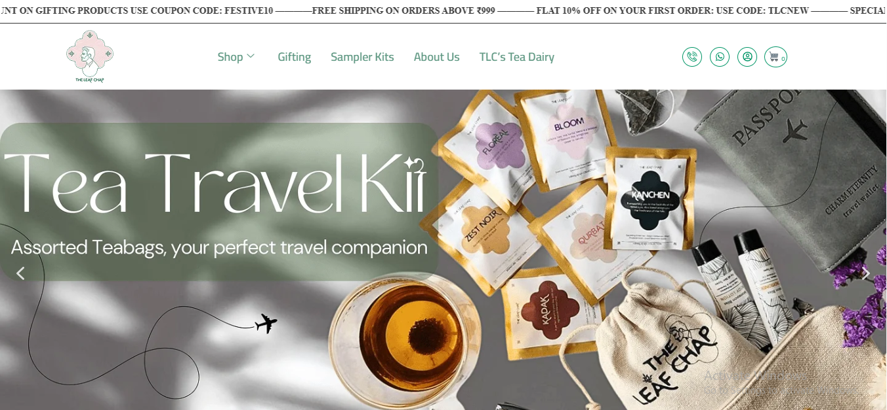
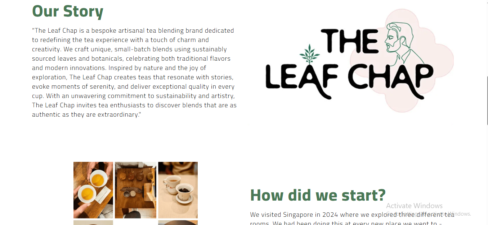

# The Laef Chap

- **Live website:** [https://theleafchap.com/](https://theleafchap.com/)
- **Platform:** WordPress
- **Page builder:** Elementor
- **Local development environment:** XAMPP

## Project overview

The Leaf Chap is an e-commerce website developed for an artisanal tea brand, designed to showcase and sell a variety of premium tea blends, herbal infusions, tea bags, and curated gifting collections.

The website provides an online shopping experience where customers can explore different tea categories, view product descriptions, select product variations, and purchase products through the online store.

It features product collections such as Artisanal Teas, Black Teas, Herbal Tisanes, Iced Teas, Tea Bags, Sampler Kits, and Gift Boxes.

## My contribution

Developed and customized website pages using WordPress and Elementor.

Designed e-commerce layouts to showcase tea products and brand collections.

Structured product categories, including Black Teas, Herbal Tisanes, Iced Teas, and Tea Bags.

Organized product listings with images, descriptions, pricing, and product variations.

Configured WooCommerce functionality for online product purchasing.

Customized product detail pages and shopping-related sections.

Structured gifting collections and sampler kit product displays.

Customized website typography, colors, images, and visual elements.

Worked on responsive layouts for desktop, tablet, and mobile devices.

Configured website plugins and components according to project requirements.

## Technologies

WordPress

Elementor

WooCommerce

PHP

MySQL

HTML5

CSS3

JavaScript

XAMPP

## Screenshots

```markdown



```