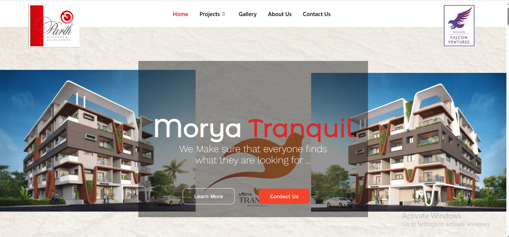
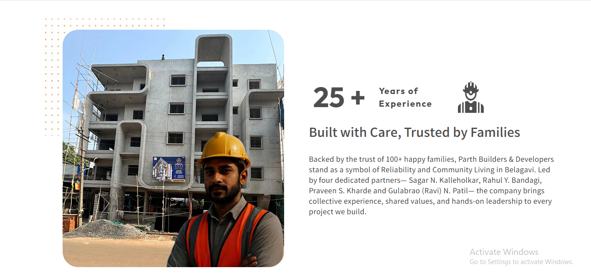
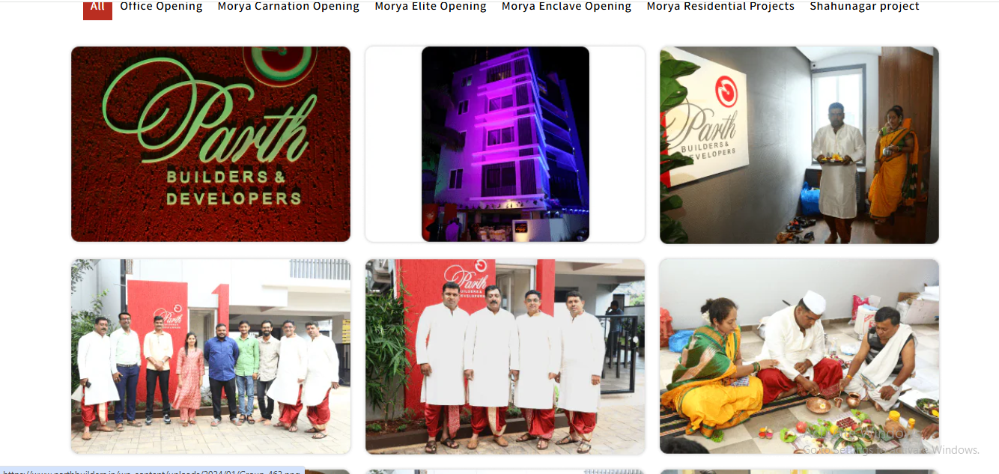
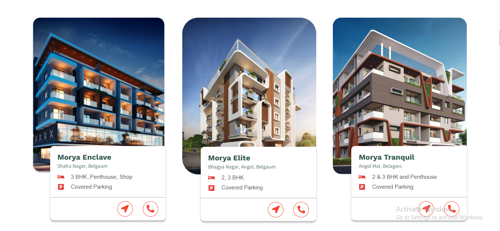

# Parth Builders

- **Live website:** [https://www.parthbuilders.in/](https://www.parthbuilders.in/)
- **Platform:** WordPress
- **Page builder:** Elementor
- **Local development environment:** XAMPP

## Project overview

Parth Builders & Developers is a real estate website developed to showcase the company's residential developments, property projects and construction portfolio.

The website presents multiple residential projects under the Morya brand, including Morya Tranquil, Morya Elite, Morya Enclave, Morya Elegant, Morya Nest, Morya Carnations and Morya Residency.

It provides information about completed and ongoing projects, property configurations such as 1 BHK, 2 BHK and 3 BHK apartments, penthouses, project locations and covered parking facilities.

## My contribution

Developed and customized website pages using WordPress and Elementor.

Designed professional layouts to showcase residential projects and company information.

Created and organized project sections for ongoing and completed developments.

Structured individual residential project listings and details.

Integrated project images, property configurations and location information.

Customized project presentation sections for apartments and penthouses.

Designed company profile and about-us sections.

Integrated customer testimonials and banking partner sections.

Customized website typography, colors, spacing and visual components.

Worked on responsive layouts for desktop, tablet and mobile devices.

Configured WordPress plugins and website components according to project requirements.

## Technologies

WordPress

Elementor

PHP

MySQL

HTML5

CSS3

JavaScript

XAMPP

## Screenshots

```markdown




```
